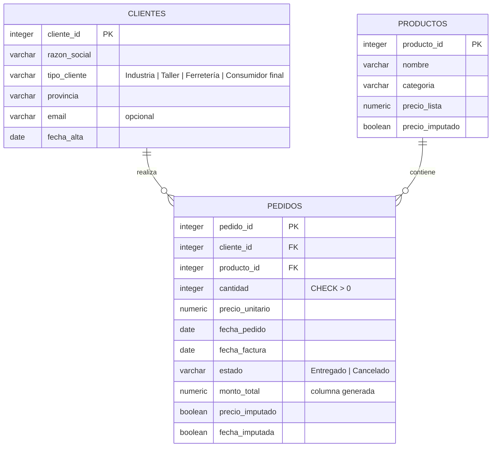

# Análisis de ventas online de una distribuidora de herramientas de corte

**Proyecto Capstone: Análisis Exploratorio de Datos (EDA) en PostgreSQL**
Autor: Luca Viliani

---

## Resumen ejecutivo

En 2025 el canal online facturó **USD 410.495** en **1.555 pedidos entregados** (ticket promedio de USD 264). Las cinco conclusiones principales para la dirección son:

1. **La facturación depende de pocos clientes B2B.** 21 clientes leales (24% de la cartera) generan el **66,9%** de los ingresos. Solo los dos mayores, ambos industrias, explican el **19,1%**.
2. **El año tiene un primer trimestre débil.** Enero factura un 55% menos que el promedio mensual y febrero un 34% menos. El primer trimestre aporta apenas el **18,8%** del año. Los picos llegan en agosto-septiembre y en noviembre.
3. **Tres categorías explican dos tercios del negocio.** Mechas, Lijas y abrasivos e Insertos de metal duro suman el **64,8%** de la facturación. Discos de corte lidera en cantidad de pedidos (30%), pero aporta solo el 9,2% del dinero.
4. **Hay productos que no coinciden con el cliente.** El disco diamantado para porcelanato no se vendió nunca y otros dos artículos para cerámica y madera casi no rotan. La cartera es metalmecánica.
5. **El consumidor final no es un canal rentable hoy.** Representa el 0,4% de la facturación y cancela el **12,5%** de sus pedidos, unas cuatro veces más que los clientes B2B.

---

## 1. Problema de negocio

La empresa vende herramientas de corte y abrasivos (discos, mechas, insertos, sierras y lijas) por su tienda online a cuatro tipos de cliente: industrias, talleres metalúrgicos, ferreterías y consumidores finales. Hasta ahora la gerencia comercial se basa en reportes de facturación total que no muestran **de dónde viene el dinero** ni **dónde se pierde**.

El análisis busca responder:

| # | Pregunta de negocio | Decisión que habilita |
|---|---|---|
| 1 | ¿Quiénes son los 5 clientes que más gastan y cuánto dependemos de ellos? | Asignar atención comercial dedicada (key accounts) |
| 2 | ¿Cómo se comportan las ventas mes a mes? ¿Hay estacionalidad? | Planificar compras e importaciones y el calendario de promociones |
| 3 | ¿Qué productos son los menos vendidos? | Liquidar, pasar a venta bajo pedido o dejar de reponer |
| 4 | ¿Cuáles son los pedidos más grandes de cada categoría? | Negociar volumen con proveedores y armar precios por cantidad |
| 5 | ¿Cuál es el perfil de nuestro cliente más leal? | Definir a quién retener y a quién intentar convertir |
| 6 | ¿En qué segmento perdemos más ventas por cancelaciones? | Priorizar mejoras de proceso (checkout, stock, entregas) |
| 7 | ¿Qué parte de la cartera explica el 80% de la facturación? | Medir el riesgo de concentración |

## 2. Dataset

- **Origen:** dataset sintético creado para este proyecto (opción "creá vos mismo 3 tablas" de la consigna). Simula la exportación del sistema de ventas online de una distribuidora argentina. Los nombres de clientes son ficticios.
- **Período:** 1 de enero al 31 de diciembre de 2025.
- **Moneda:** USD. Se eligió dólar para que la comparación entre meses no quede distorsionada por la inflación.
- **Volumen:** 30 productos en 7 categorías, 90 clientes y 1.662 filas de pedidos crudos.
- **Calidad:** los datos crudos incluyen a propósito los problemas típicos de un export real: duplicados, nulos, fechas en dos formatos, precios con coma decimal o con `N/A`, y categorías y provincias escritas de varias formas.

## 3. Modelo de datos

Se trabaja en dos capas:

- **`staging`**: los datos tal como llegan, todo en `TEXT`, para que la carga nunca falle por un formato inesperado.
- **`public`**: el modelo limpio, con tipos correctos (`DATE`, `NUMERIC`, `INTEGER`), llaves primarias y foráneas y restricciones `CHECK`.



Decisiones de diseño:
- Los importes son `NUMERIC` y no `FLOAT`, porque el dinero necesita precisión exacta.
- `monto_total` es una **columna generada** (`cantidad * precio_unitario`): la calcula el motor, así que no puede quedar mal cargada.
- Las banderas `*_imputado/a` registran qué valores no son originales, para poder auditarlos.
- Hay índices solo en las columnas que usan los `JOIN` y los filtros por fecha (`cliente_id`, `producto_id`, `fecha_pedido`). Indexar de más encarece las cargas sin mejorar las consultas.

## 4. Limpieza de datos

Toda la limpieza está en la sección 4 de `estructura.sql`, y la sección 0 de `analisis.sql` la verifica con números.

| Problema detectado en el origen | Casos | Regla aplicada |
|---|---|---|
| Pedidos duplicados (reenvíos de la integración) | 12 | `DISTINCT ON (pedido_id)` |
| Cantidad nula o 0 | 29 | Se descartan: no representan una venta y no se puede inventar la cantidad |
| Precio unitario faltante | 132 pedidos | `COALESCE` en cascada: 1° precio promedio que pagó **el mismo tipo de cliente** por ese producto (respeta su descuento), 2° precio de lista |
| Fecha de pedido vacía | 107 pedidos | `COALESCE(fecha_pedido, fecha_factura)`. La factura se emite 0 a 3 días después, y en ningún caso imputado cambió el mes |
| Fechas en formato `DD/MM/YYYY` mezcladas con `YYYY-MM-DD` | 400 | `CASE` según el patrón del texto + `TO_DATE` |
| Precio de lista con coma decimal, vacío o `N/A` | 2 nulos | `NULLIF` + `REPLACE(',', '.')`. Para los nulos, `COALESCE` con el máximo precio cobrado (los descuentos solo lo bajan) y, si no hubo ventas, con el promedio de la categoría |
| Categorías escritas distinto (`DISCOS DE CORTE`, `  discos de corte `) | 17 variantes → 7 | `TRIM` + mayúscula inicial |
| Provincias escritas distinto (`Bs As`, `Capital Federal`, `Cordoba`) | 18 variantes → 8 | Clave normalizada (minúsculas, sin tildes) + `CASE` |
| Tipo de cliente y estado con mayúsculas o tildes inconsistentes | 10 → 4 y 6 → 2 | `TRANSLATE` / `INITCAP` + `CASE` |
| Clientes duplicados | 2 | `DISTINCT ON (cliente_id)` |
| Email vacío | 17 clientes (19%) | Se deja `NULL`: no es una columna crítica y un email inventado sería peor que uno vacío |

**Impacto de la imputación:** el 7,4% de la facturación usa un precio imputado. Es un porcentaje bajo y no cambia ninguna conclusión, pero se informa para que el lector lo sepa.

**Control de explosión de filas:** se verificó que unir `pedidos` con `clientes` y `productos` devuelve las mismas 1.621 filas. Las relaciones son muchos-a-uno y ninguna suma está inflada.

## 5. Hallazgos

> "Venta" = pedido con estado `Entregado`. Las cancelaciones se analizan por separado en el punto 5.6.

### 5.1 Top 5 clientes: alta dependencia de pocas industrias

| Cliente | Tipo | Pedidos | Gasto (USD) | % de la facturación |
|---|---|---:|---:|---:|
| Aceros Norte SRL | Industria | 64 | 39.467 | 9,6% |
| Autopartes Güemes SA | Industria | 69 | 39.170 | 9,5% |
| Aceros Central SRL | Industria | 63 | 30.906 | 7,5% |
| Metalmecánica del Litoral SA | Industria | 42 | 21.394 | 5,2% |
| Fundición Central SA | Industria | 32 | 14.512 | 3,5% |

**Qué significa:** los cinco son industrias y juntos explican el **35,3%** de los ingresos. La empresa tiene solo 5 clientes industriales, y entre ellos generan más de un tercio del negocio. Cada uno de los dos primeros (Aceros Norte y Autopartes Güemes) factura más que un mes promedio de la empresa (USD 34.200): perder a uno equivale a perder un mes entero de ventas.
**Recomendación:** asignarles un ejecutivo de cuenta, con acuerdos de precio por volumen y seguimiento mensual de su frecuencia de compra para detectar a tiempo una baja.

### 5.2 Ventas por mes: verano flojo, segundo semestre fuerte

| Mes | Facturación (USD) | vs. promedio anual |
|---|---:|---:|
| Ene | 15.279 | **-55%** |
| Feb | 22.571 | -34% |
| Mar | 38.717 | +13% |
| Abr | 38.739 | +13% |
| May | 31.996 | -6% |
| Jun | 32.527 | -5% |
| Jul | 27.764 | -19% |
| Ago | 42.818 | +25% |
| Sep | 46.513 | **+36%** |
| Oct | 32.136 | -6% |
| Nov | 43.570 | +28% |
| Dic | 37.327 | +9% |

**Qué significa:** el patrón acompaña al calendario industrial argentino. En enero y febrero hay vacaciones y paradas de planta, y julio coincide con el receso de invierno. El primer trimestre aporta solo el **18,8%** del año, frente al 27-28% de cada trimestre del segundo semestre. La caída de octubre (-31% frente a septiembre) no tiene una explicación estacional evidente: con un único año de datos no se puede saber si es un patrón o un hecho puntual.
**Recomendación:**
- Programar los arribos de importación para **marzo y agosto**, antes de las subas, y no en diciembre-enero, cuando el stock quedaría inmovilizado durante el verano.
- Concentrar promociones y la liquidación de stock lento en enero, febrero y julio.
- Revisar octubre con el área comercial (cambios de precio, faltantes de stock, feriados).

### 5.3 Productos menos vendidos: un problema de surtido, no de precio

| Producto | Categoría | Pedidos | Unidades |
|---|---|---:|---:|
| Disco diamantado turbo 115mm porcelanato | Discos de corte | **0** | 0 |
| Sierra copa diamantada 68mm | Sierras copa | 7 | 70 |
| Hoja sin fin carbono 13x0.65 madera 2.3m | Sierras sin fin | 3 | 111 |

**Qué significa:** los tres artículos sirven para materiales que no son metal (porcelanato, cerámica, madera), y la cartera es metalmecánica. El disco para porcelanato está publicado y no tuvo ni una venta en 12 meses. No es un problema de precio: es un producto que no coincide con quien compra.
**Recomendación:** pasar estos artículos a **venta bajo pedido** y no reponer stock. Si la empresa quiere entrar en construcción, necesita un canal y clientes distintos, no solo agregar productos al catálogo.

### 5.4 Ranking por categoría: las líneas de mayor valor dependen de la industria

| Categoría | Pedidos | Facturación (USD) | % | Ticket promedio (USD) |
|---|---:|---:|---:|---:|
| Mechas | 273 | 100.435 | 24,5% | 368 |
| Lijas y abrasivos | 212 | 89.508 | 21,8% | 422 |
| Insertos metal duro | 149 | 75.962 | 18,5% | 510 |
| Sierras copa | 108 | 41.438 | 10,1% | 384 |
| Discos de corte | 473 | 37.890 | 9,2% | **80** |
| Sierras sin fin | 73 | 35.207 | 8,6% | 482 |
| Discos flap | 267 | 30.054 | 7,3% | 113 |

El `RANK()` de los 3 pedidos más grandes de cada categoría muestra que **17 de los 21 puestos son de industrias** y que **Aceros Norte SRL ocupa 8**. Los pedidos tope de insertos y hojas sin fin son de 20 a 28 unidades. En consumibles (mechas, lijas) superan las 100 unidades.

**Qué significa:** Discos de corte es el producto de **tráfico**: es el pedido más frecuente (30% de los pedidos) pero de ticket bajo. Hace volver al cliente y no genera margen por sí solo. El dinero está en mechas, abrasivos e insertos.
**Recomendación:** usar el disco de corte como "gancho" para la venta cruzada (por ejemplo, sugerir discos flap y lijas en el mismo pedido). Negociar con los proveedores de mechas, abrasivos e insertos con los volúmenes del ranking como base.

### 5.5 Perfil del cliente leal

| Segmento (pedidos/año) | Clientes | % clientes | % facturación | Pedidos promedio | Ticket (USD) |
|---|---:|---:|---:|---:|---:|
| Leal (24+) | 21 | 23,9% | **66,9%** | 42 | 312 |
| Recurrente (6 a 23) | 48 | 54,5% | 32,1% | 13 | 214 |
| Ocasional (1 a 5) | 19 | 21,6% | 1,0% | 3 | 69 |

**El cliente leal típico** es un comprador B2B (9 talleres metalúrgicos, 7 ferreterías y 5 industrias) que pide casi **una vez por semana** con un ticket de USD 312. **Ningún consumidor final** llega a este segmento: 13 de los 19 ocasionales son consumidores finales.
**Recomendación:** los **48 recurrentes**, casi todos talleres y ferreterías, son la cantera de crecimiento. Si 10 de ellos pasaran a comprar con frecuencia de leal, el impacto sería mayor que cualquier campaña al consumidor final. Una opción concreta es un programa de reposición programada o una lista de precios por frecuencia de compra.

### 5.6 Ventas perdidas por cancelaciones

| Tipo de cliente | Tasa de cancelación | Monto perdido (USD) |
|---|---:|---:|
| Consumidor final | **12,5%** | 478 |
| Ferretería | 4,5% | **6.991** |
| Industria | 3,2% | 4.192 |
| Taller metalúrgico | 3,0% | 3.811 |

**Qué significa:** en total se cancela el 4,1% de los pedidos, con **USD 15.472 perdidos**. La lectura cambia según qué se mida:
- Por **proceso**, el problema está en el consumidor final: cancela cuatro veces más que el B2B, lo que apunta al checkout web (medios de pago, costo de envío visible recién al final).
- Por **dinero**, la prioridad son las ferreterías: concentran casi la mitad del monto perdido.

**Recomendación:** investigar los motivos de cancelación de las ferreterías (¿stock publicado sin respaldo? ¿plazos de entrega?) antes de invertir en mejorar el checkout B2C.

### 5.7 Concentración de la cartera

**31 de 88 clientes con compras (35%) explican el 80% de la facturación.** Hay concentración, pero menos extrema que el 80/20 clásico, porque las ferreterías y los talleres aportan una base amplia de compras medianas. El riesgo no está en la cartera completa sino en los 5 clientes industriales del punto 5.1.

## 6. Recomendaciones para la dirección

1. **Proteger las cuentas clave:** crear un programa de key accounts para las 5 industrias, que concentran el 35% de los ingresos.
2. **Hacer crecer a los recurrentes:** ofrecer reposición programada y precios por frecuencia a los 48 talleres y ferreterías recurrentes.
3. **Planificar con la estacionalidad:** programar las importaciones para marzo y agosto, y las promociones y liquidaciones para enero, febrero y julio.
4. **Depurar el surtido:** pasar a venta bajo pedido los artículos para materiales no metálicos.
5. **Atacar las cancelaciones por monto:** empezar por las ferreterías y después por el checkout B2C.

## 7. Limitaciones

- Los datos son sintéticos: las cifras ilustran el método de análisis y no describen a una empresa real.
- Hay un solo año de historia. La estacionalidad se debería confirmar con 2026 antes de usarla para planificar.
- El 7,4% de la facturación usa precios imputados, y 107 fechas se tomaron de la fecha de factura (ninguna cambió de mes).
- El dataset no incluye costos, así que se analiza facturación y no rentabilidad.

## 8. Cómo ejecutar el proyecto

**Requisitos:** PostgreSQL 12 o superior (probado en 16) y pgAdmin 4 o `psql`.

### Opción A: pgAdmin
1. Clic derecho en **Databases → Create → Database…**, con nombre `capstone_project`.
2. Seleccionar la base `capstone_project` y abrir **Query Tool**.
3. Abrir `estructura.sql` y ejecutarlo completo (F5). Al final muestra un control de filas crudas contra filas limpias.
4. Abrir `analisis.sql` y ejecutar cada bloque por separado (seleccionarlo y F5) para ver cada resultado.
5. Opcional: clic derecho en la base → **ERD Tool** para ver el diagrama de las tablas.

### Opción B: psql
```bash
createdb capstone_project
psql -d capstone_project -f estructura.sql
psql -d capstone_project -f analisis.sql
```

`estructura.sql` se puede volver a ejecutar sin problemas: borra y recrea todo en cada corrida.

## 9. Estructura del repositorio

```
.
├── estructura.sql   # Esquemas, carga de datos crudos, tablas tipadas, limpieza e índices
├── analisis.sql     # Diagnóstico de calidad + 7 preguntas de negocio, comentadas
└── README.md        # Este documento
```

## 10. Técnicas SQL utilizadas

| Técnica | Dónde |
|---|---|
| `JOIN` (INNER y LEFT) entre 2 y 3 tablas | Preguntas 1, 3, 4, 5, 6 |
| `GROUP BY` + `SUM` / `COUNT` / `AVG` | Todas las preguntas |
| Funciones de ventana: `RANK()`, `LAG()`, `ROW_NUMBER()`, `SUM() OVER` | Preguntas 1, 2, 4, 5, 7 |
| `CASE` | Limpieza (fechas, provincias, tipos), preguntas 5 y 6 |
| `COALESCE` / `NULLIF` | Limpieza de precios y fechas, pregunta 3 |
| CTE (`WITH`) | Limpieza y preguntas 1, 2, 4, 5, 7 |
| Funciones de fecha: `DATE_TRUNC`, `EXTRACT`, `TO_DATE`, `TO_CHAR` | Limpieza y pregunta 2 |
| `FILTER (WHERE …)` | Diagnóstico de calidad, preguntas 5 y 6 |
| Columna generada, `CHECK`, PK/FK, índices B-Tree | Modelo de datos |
